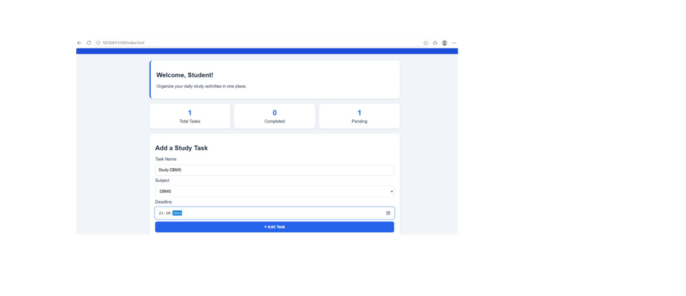
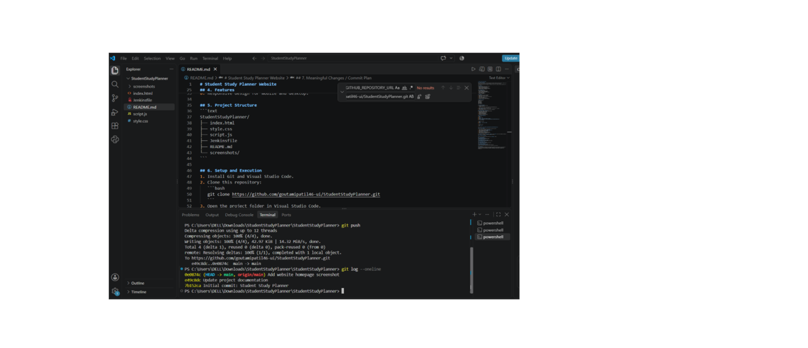
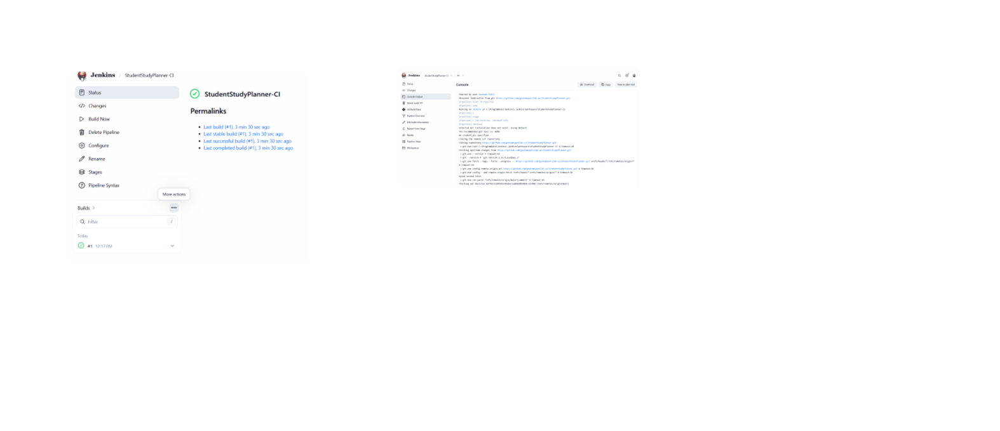

# Student Study Planner Website

## 1. Project Introduction
The Student Study Planner is a simple web application that helps students organize study tasks, subjects, and deadlines. Users can add tasks, mark them complete, delete them, and track their progress.

This project demonstrates web development, Git/GitHub version control, and basic Continuous Integration (CI) using Jenkins.

## 2. Objectives
- Develop a simple and user-friendly website.
- Manage study tasks and deadlines.
- Learn Git and GitHub version control.
- Maintain at least five meaningful commits.
- Integrate Jenkins for website file validation.
- Document the project and evidence.

## 3. Technology Stack
- HTML — website structure
- CSS — styling and responsive layout
- JavaScript — website functionality
- Browser localStorage — save tasks locally
- Git — version control
- GitHub — online repository
- Jenkins — CI pipeline

## 4. Features
1. Add tasks with a subject and deadline.
2. Mark tasks as completed or pending.
3. Delete tasks.
4. Display total, completed, and pending task counts.
5. Search by task name or subject.
6. Filter tasks by status.
7. Save tasks in browser localStorage.
8. Responsive design for mobile and desktop.

## 5. Project Structure
```text
StudentStudyPlanner/
├── index.html
├── style.css
├── script.js
├── Jenkinsfile
├── README.md
└── screenshots/
```

## 6. Setup and Execution
1. Install Git and Visual Studio Code.
2. Clone this repository:
   ```bash
   git clone https://github.com/goutamipatil46-ui/StudentStudyPlanner.git
   ```
3. Open the project folder in Visual Studio Code.
4. Open `index.html` with the Live Server extension, or open the file in a browser.
5. Add and manage study tasks.
6. Refresh the page to verify tasks remain saved in localStorage.

## 7. Meaningful Changes / Commit Plan
Record the actual commits you make. Suggested changes:
1. Create initial website structure.
2. Add responsive website styling.
3. Implement study task form.
4. Add task completion and deletion.
5. Save tasks in localStorage.
6. Add task search and filters.
7. Add Jenkins CI validation pipeline.

## 8. Git and GitHub Workflow
Initial setup:
```bash
git init
git branch -M main
git add .
git commit -m "Create initial website structure"
git remote add origin https://github.com/goutamipatil46-ui/StudentStudyPlanner.git
git push -u origin main
```

For subsequent changes:
```bash
git add .
git commit -m "Describe the change"
git push
```

View commit history:
```bash
git log --oneline
```

Repository URL: `https://github.com/goutamipatil46-ui/StudentStudyPlanner.git`

## 9. Jenkins Integration
Jenkins is used to demonstrate a basic Continuous Integration pipeline.

1. Install Jenkins and complete initial setup.
2. Create a Pipeline job named `StudentStudyPlanner-CI`.
3. Select **Pipeline script from SCM**.
4. Choose Git and enter this repository's URL.
5. Set the branch to `*/main`.
6. Save the job and click **Build Now**.
7. Open the build and select **Console Output**.
8. Confirm the pipeline succeeds.

The `Jenkinsfile` checks that `index.html`, `style.css`, and `script.js` exist in the checked-out repository. This is basic file validation, not a full JavaScript test suite.

## 10. Screenshots and Evidence

Capture your own screenshots and save them in the `screenshots/` folder.

### 10.1 Running Website
Add `screenshots/website.png`:


### 10.2 GitHub Repository
Add `screenshots/github-repository.png`:


### 10.3 Git Commit History
Add `screenshots/git-history.png`:


### 10.4 Jenkins Integration
Add `screenshots/jenkins-success.png`:


Replace these placeholder images with your real screenshots before submission.

## 11. Conclusion
The Student Study Planner demonstrates web development using HTML, CSS, and JavaScript. Git and GitHub are used to track and share code changes, while Jenkins validates the required website files through a CI pipeline. The project provides practical experience in development, version control, automation, and documentation.
